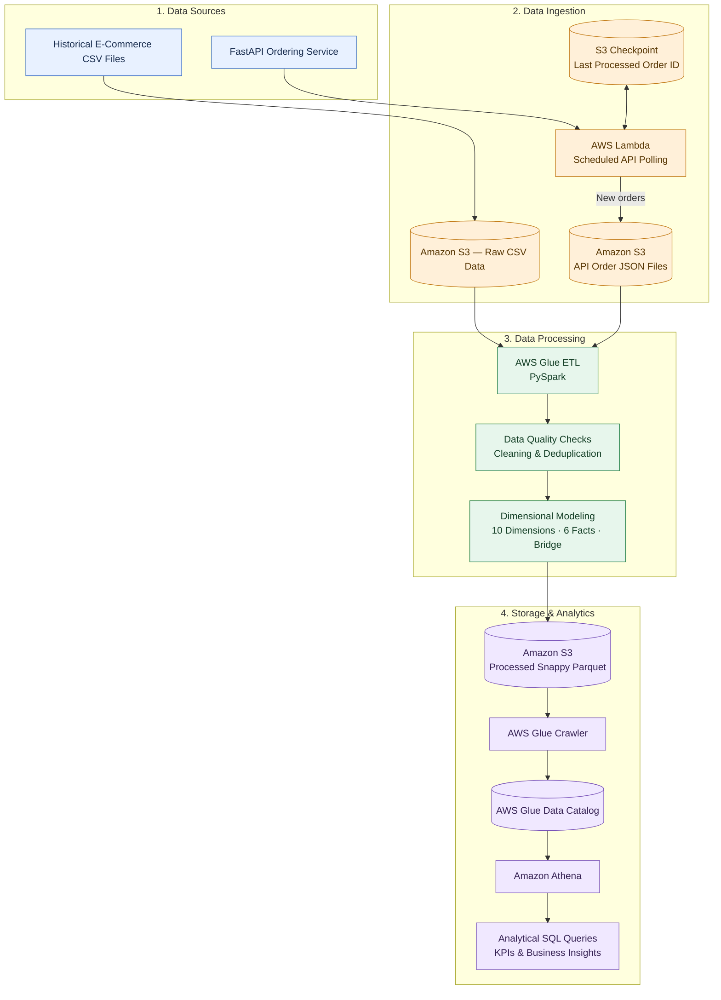

# E-Commerce Data Warehouse on AWS

An end-to-end data engineering project: historical CSVs plus a live ordering API are ingested into S3, modeled into a star schema with AWS Glue (PySpark), cataloged with a Glue Crawler, and queried with Amazon Athena.

## Architecture




## Repository layout

| Path | What it is |
|------|-----------|
| `api/ordering_api.py` | FastAPI service that simulates incremental orders (orders, details, payment, shipment) and exposes `GET /api/orders` for ingestion |
| `api/app.py` | Minimal health-check FastAPI app |
| `ingestion/lambda_function.py` | Lambda that polls the API using an OrderID checkpoint and writes one JSON file per order to S3 |
| `etl/ecommerce_transformation.ipynb` | Glue PySpark notebook: reads CSV + API JSON, cleans, builds 10 dimensions, 6 facts and a bridge table |
| `infra/redshift_permissions.txt` | CloudShell commands for an S3-read IAM role (originally for Redshift) |
| `docs/Ecommerce_DW_Documentation.pdf` | Full project documentation, data quality checks and Athena analytics queries |

## Key design points

- **Incremental ingestion:** the Lambda stores the last processed OrderID in S3 and only fetches newer orders, so re-runs are idempotent.
- **Deduplication:** historical and API records are unioned, then deduplicated on each table's natural key.
- **Star schema:** `dim_customer`, `dim_product`, `dim_date`, and others, plus `fact_order`, `fact_order_detail`, `fact_payment`, `fact_shipment` and aggregate facts.
- **Athena instead of Redshift:** Parquet is queried in place through the Glue Data Catalog, with no cluster to manage.

## Running it

**1. Start the API**

```bash
pip install fastapi uvicorn
cd api
uvicorn ordering_api:app --reload
# generate sample orders
curl -X POST http://localhost:8000/orders/test-batch/50
```

**2. Deploy the Lambda** with these environment variables:

| Variable | Example |
|----------|---------|
| `BUCKET` | your S3 bucket name |
| `API_URL` | public URL of the API's `/api/orders` endpoint (e.g. via ngrok or a deployed host) |

**3. Run the Glue notebook** in `etl/`, replacing `your-bucket-name` with your bucket, then run the Glue Crawler on the output prefix and query in Athena.

## Known limitations

- `dim_product.department_id` is always NULL because the source data has no product-to-department path.
- The Glue job recomputes everything each run instead of merging only new records (a manifest or job bookmarks would fix this).
- The API keeps stock and ID counters in memory, so they reset on restart.

## Tech stack

Python, PySpark, FastAPI, AWS Lambda, S3, Glue, Glue Data Catalog, Athena, boto3
